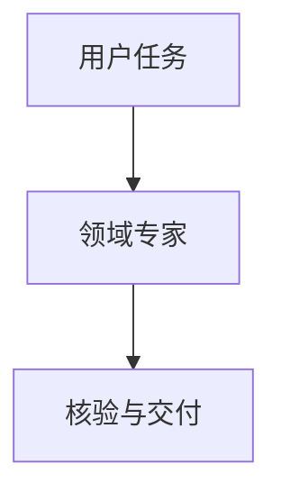

# 博客格式与 Obsidian 配置维护

编辑器的格式、样式和预览适配均在本博客仓库维护。Obsidian 插件是读取这些配置的通用宿主，日常格式变更不需要重新安装插件。

## 改哪里、何时生效

| 需求 | 修改位置 | 生效方式 |
| --- | --- | --- |
| 菜单名称、顺序、新增已有格式变体 | `editor/blog-editor.json` 的 `formats` | 保存后重新打开右键菜单 |
| 表单标签、默认作者、折叠标题 | 对应格式的 `fields` / `attributes` | 保存后重新选择格式 |
| 正文配色、间距、卡片样式 | `src/styles/article.css` | 关闭预览再打开 |
| 预览基础主题样式 | `editor/preview.css` | 关闭预览再打开 |
| 新增博客语法的解析 | `src/plugins` 中博客实际使用的模块；必要时调整 `editor/renderer.mjs` | `pnpm editor:build` 后重新打开预览 |
| 新增仅预览需要的处理/交互 | `editor/adapter.mjs` | `pnpm editor:build` 后重新打开预览 |

配置不会自动给博客增加语法。配置声明“如何插入”，博客解析模块决定“如何显示”。如果只是给已有 quote 增加一种默认作者，不需要写解析代码；如果创造一个全新的 carousel 指令，则必须先实现博客和预览需要的解析。

## 示例：新增一个“摘录”菜单项

在 `formats` 数组里增加下列对象（注意与前一个对象之间加逗号）：

```json
{
  "id": "excerpt-quote",
  "name": "摘录",
  "kind": "container",
  "directive": "quote",
  "attributes": { "author": "{{author}}" },
  "fields": [
    { "key": "author", "label": "摘录来源", "default": "读书笔记" }
  ]
}
```

右键菜单按数组顺序排列。选择“摘录”后会询问来源，并生成：

```markdown
:::quote{author="读书笔记"}
选中的文字
:::
```

这个例子复用博客已支持的 quote，不需要构建。没有选中文字时，默认填入“在这里填写内容”；可用 `placeholder` 覆盖。插件自动处理参数转义、外层嵌套冒号长度、前后空行和撤销。

## 字段含义

- `id`：唯一且稳定的标识，只用英文、数字、下划线、短横线；不要重复。
- `name`：右键菜单显示名称。
- `kind`：`container` 生成包裹正文的 `:::...`；`leaf` 生成独立的 `::...` 卡片。
- `directive`：博客解析器实际识别的语法名，例如 `quote`、`audio`。
- `attributes`：指令参数；`{{author}}` 等占位符引用同名输入字段。常量值直接写字符串，例如 `"class": "article-serif-center"`。
- `fields`：弹窗输入项；`key` 对应占位符，`label` 是显示名称，`default` 是默认值；`required: true` 表示必填。
- `fields[].type`：默认 `text`；`audio-url` 检查公开路径/HTTP(S) 地址；`repository` 接受 owner/repo 或 GitHub 仓库网址。
- `picker: "post"`：使用文章搜索器并提供 `{{slug}}` 参数，不需要手填路径。

## 顶层配置

- `schemaVersion`：当前固定为 1，不要随意更改。
- `postsPath`：相对 Obsidian 工作区的文章目录，当前为 `posts`。
- `publicPath`：相对博客根目录的公开资源目录。
- `siteUrl` / `postUrlPrefix`：站点地址与文章 URL 前缀。
- `styles`：按顺序读取的 CSS 路径，相对博客根目录。
- `renderer`：预览适配产物，相对博客根目录；当前为 `editor/dist/adapter.cjs`。
- `themes`：预览下拉框选项。新增主题时要同时让博客侧适配器理解该 ID，并增加对应样式，不能仅新增一个名称。

插件设置只需填写博客根目录与配置路径。博客根目录留空时从 content 工作区向上查找默认配置。配置中的 renderer 是本地执行模块，应当始终指向你维护的可信项目代码，不接受文章内容提供的模块路径。

## 命令

首次安装/更换电脑：

```powershell
npm install --prefix editor
pnpm editor:build
pnpm editor:test
```

日后修改 JS 解析/交互后：

```powershell
pnpm editor:build
pnpm editor:test
```

上述操作不启动 Astro、不构建整站、不部署。JSON 和 CSS 更新无需这些命令。构建出的 adapter 会被插件按内容变化重新加载，不需要重新安装或重启 Obsidian。整篇预览是快照，需要返回编辑再打开；单栏实时预览会在下一次编辑后重新读取，也可关闭再开启以立即刷新。

## 发布与 Git

把 `editor` 的源码、配置及依赖清单随博客提交；node_modules、生成字体和 dist 已忽略。插件仓库不需要提交博客专属代码。新机器先执行首次安装命令。博客新增格式时同时检查配置、解析和预览，是一次博客提交内的工作，不再跨仓库同步代码。

## 接口与限制

适配器导出 `apiVersion = 1` 和异步 `renderPreview(context)`，返回 `{ html, missing }`；当宿主传入 `live: true` 时额外返回 `blocks: [{ from, to, html }]`（UTF-16 源码偏移，不含 Frontmatter）。宿主提供编辑器快照、当前文件、主题、配置、本地资源读取和文章查找；适配器负责站点专属渲染，HTML 展示在不授予同源权限的 iframe 中。

当前适配器使用离线 GitHub 卡片、基础代码块；Mermaid 已支持本地离线图表，博客与预览共用解析和主题渲染模块。

## Mermaid 图表

使用标准围栏语法，无需给文章添加额外字段，也无需创建新 JSON 指令：

````markdown

````

- 图表跟随明暗主题及蓝/金主题色，使用系统字体，统一自适应容器宽度，不显示顶部工具栏。
- 博客只在图表接近可视区域时加载本地 Mermaid 资源；不依赖外部 CDN。
- 源码始终可展开查看；渲染失败不会隐藏文章，单张图表可重试。
- 修改 Mermaid 运行时后执行 `pnpm editor:build`；依赖由博客根目录锁定，首次构建先执行 `pnpm install`。
- 插件 0.3.1 支持 `data-preview-selector` 条件脚本：图表库只注入含图表的实时预览块。旧插件的整篇预览仍可显示，但建议升级以避免每个段落都载入图表库。
- 本次升级需要重建并安装插件 0.3.1，再在 Obsidian 停用/启用一次。后续调整图表样式只需更新博客侧 CSS/适配器。

## 单栏实时预览

配合插件 0.3.0，可在原编辑区显示博客样式，点击块编辑源码。博客适配器先完整解析文章，再为顶层块提供源码范围，因此表格、嵌套指令和脚注引用的解析仍共享整篇上下文。正文样式中的表格竖线与脚注括号同时用于整篇和实时预览。升级后执行 `pnpm editor:build`，插件需重新构建、安装、启用。
