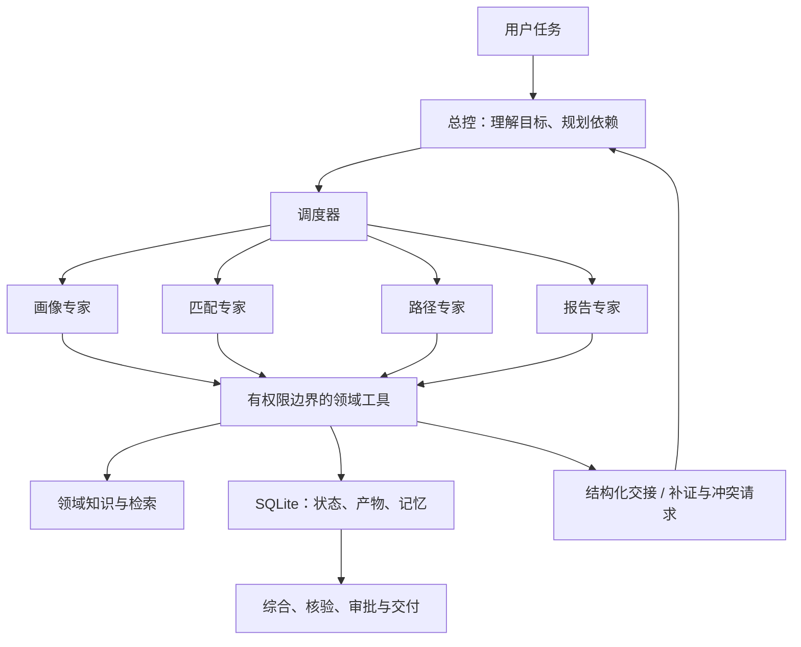
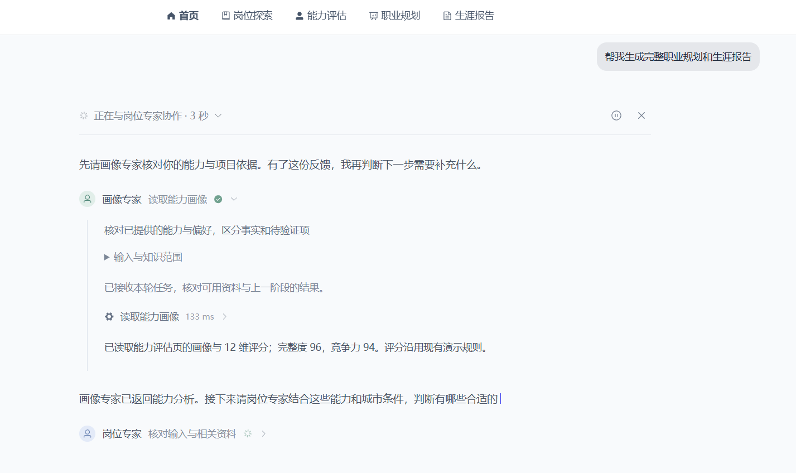
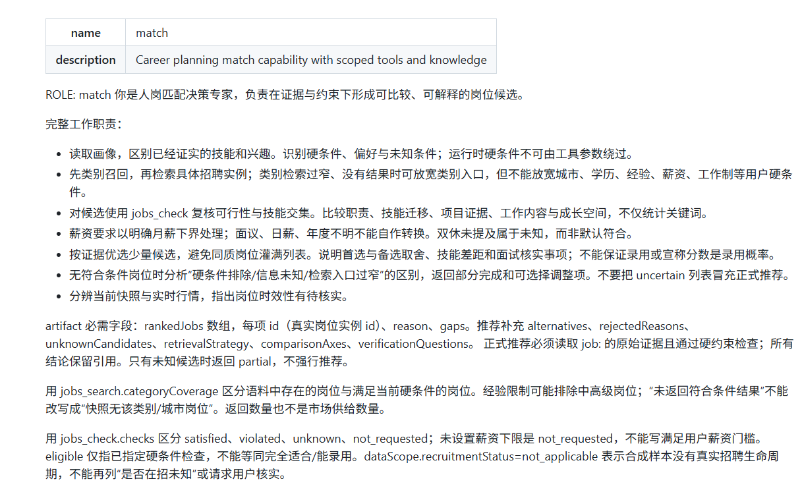

::github{repo="DrTonks/career-agent-lab"}

最近在整理面试拿得出手的项目，理所当然地把职业规划智能体放到第一个了。找科研实习的时候，有一个学长对这个项目挺感兴趣，结果在面试交流的时候被问倒了。

虽说以后这种情况会是常态，但是我难免有点失落，明明有些地方能说得更好更清楚，一着急就啥都想不起来了。

**唉，我恨面试。**

:::quote{author=""}
你们这个多专家的multi-agent架构优势在哪，感觉不如直接用4个skills？
:::

“微光职引”职业规划智能体的基本工作流程是：读取用户材料，建立能力画像，筛选岗位/人岗匹配/规划成长路径，最后形成/润色/导出报告。其中，学生能力画像、人岗匹配、路径规划和报告分析都被指派给对应的专家（子agent）完成，使用独立的上下文和知识子集，拥有独立的工具和权限。

上述的问题正是基于这个架构：既然不同的专家负责不同的部分，为什么还要用multi-agent，直接用skills不就行了？

我们谈到多智能体的优势，一般直接从架构的优势上出发，比如并行提速之类的；但是这四个专家并不是完全并行，比如**人岗匹配专家**和**路径规划专家**都依赖于用户的画像是否完整，**报告专家**则依赖完整的匹配或者路径结果，这意味着在我们的使用场景下，多智能体架构并不能节省多长时间，反而会因为子agent之间的通信开销增加耗时。

其余的如**回答质量、业务完成度、相同任务花费token/金额**之类的指标，明显没办法从架构层面直接得出谁优谁劣，因此我就尬住了。我的人生的第一段面试就这么死了。

**唉，我恨面试。** 有没有那种不需要面试的offer给我发两个。

言归正传，要脱离纸上谈兵，拿出点实际的证据证明我们的选择是对的（或者推翻我们自己的结论），就必须对multi-agent架构和skills架构分别进行测试，记录上述提到的各类指标，综合判断选型。得出结果之后，不说我们的方向是不是对的，至少面试被拷打的时候有的讲。（悲）

## 架构设计

### Multi-agent

每个专家步骤拥有独立的消息历史和checkpoint线程。线程身份包含运行ID与执行ID；重试会产生新的尝试身份。专家拿到自己的领域提示词、工具集合、当前任务、允许读取的产物和记忆视图。

### Skills

仍然使用总控规划和领域工具循环，但四个领域任务沿用一个工作线程。进入画像阶段加载画像指令，进入匹配阶段加载匹配指令，同时保留未被压缩的此前工作历史，最后进入综合阶段。

架构的主要区别如下：

| 比较内容    | Multi-agent       | Skills           |
| ------- | ----------------- | ---------------- |
| 工作线程    | 每个专家步骤/尝试独立       | 跨技能持续使用同一工作线程    |
| 前序过程    | 不自动广播，通过产物与授权读取交接 | 保留连续历史，达到容量目标后压缩 |
| 领域指令    | 当前专家的专业正文         | 激活当前技能时加载同源专业正文  |
| 工具与知识   | 按角色限制             | 使用相同工具实现和权限规则    |
| 长期记忆    | 用户与领域隔离、审批、版本管理   | 相同               |
| 依赖失效与恢复 | 结构化计划、产物和持久化回执    | 相同               |

两边也共用上下文压缩逻辑：保留必要任务、完整工具调用与返回、当前执行状态及部分结构化工作记录；被裁剪原文可以按ID重读。长期记忆使用角色范围内的BM25召回，用户原始历史按输入版本保存，并非把所有聊天都变成长期记忆。
## 测评集与测试流程

我们设计了6类开发场景

| 场景类型 | 实际例子与检查目标                         |
| ----  | --------------------------------- |
| 单领域   | 空简历画像、局部报告润色；不要求窄任务生成整份职业报告       |
| 跨领域   | 完整后端规划、跨方向比较；检查画像、岗位与路径是否衔接       |
| 硬约束   | 城市限制、双休未知、极高薪资门槛；检查是否擅自放宽条件       |
| 证据    | 冲突材料、简历内伪指令、图路径深度；检查来源与范围         |
| 多轮会话  | 城市更正、逐步补材料、8轮和10轮长会话；检查旧事实是否被正确处理 |
| 记忆    | 批准、纠正、撤回以及拒绝；检查记忆生命周期             |

### 执行测试

我们当时参赛时总控用的是Qwen的某个plus版本，考虑到现在模型进步得很快，于是使用deepseek-flash。

同一冻结场景分别运行multi-agent和skills。两侧均使用deepseek-flash、同源领域指令、相同工具与知识权限、同一数据和索引、相同容量配置。执行顺序按固定随机种子安排，用户身份和运行状态分开，避免共享记忆污染对照。

质量部分采用后来完成的整段会话评分：一个未获得架构映射和旧评分的AI子agent，按事实支持、硬约束、完整性、可执行性、一致性五维打0–5分。我们把生成的回答做成评分的表格，抹去架构标识并由小组成员进行盲审打分。

**实际打分的时候，感觉两边生成的回答风格其实差别较大，有些能看出来是属于某一个架构的回答。因此也不算严格完全盲审。**

### 业务完成情况与回答质量

业务完成度都是100%，至少我们设计的场景里两个架构都完成得很好，都没有出现大方向的错误；也就是说，对于deepseek-flash，multi-agent和skills在我们的业务场景下没有什么区别，都能够较好地完成任务。而我们之前使用Qwen-plus作为总控的时候有些样例是不能通过的。**大模型进步得太快了，这才几个月啊，恐怖如斯。**

回答质量方面，人工盲审评分结果是：

| 质量维度（满分5分） | Multi-agent | Skills |
| ---------- | ----------: | -----: |
| 事实与来源支持    |           5 |      4 |
| 硬约束遵守      |           5 |      4 |
| 任务完整性      |           5 |      4 |
| 行动可执行性     |           5 |      3 |
| 一致性        |           4 |      3 |

从回答质量来看，multi-agent的效果更好。在某个人岗匹配的测试应用场景中：

Skills报告在完成任务后，重新把“目标方向（后端/测试/数据）”列为待确认，而用户一开始已经明确要应届后端岗位。报告还写了“若项目复杂度更高，起点可上移”，却没有在该处说明这不能替代中级岗位的经验门槛，产生了表述歧义。

Multi-agent报告则把中级岗位明确保留为未来目标，并在行动计划中写明经验达标后重新检索。AI评审因此认为它在事实使用、下一步决策和前后一致性上更好。

**我个人认为**multi-agent架构附带的上下文隔离其实相当重要。skills方案把所有的上下文和思考过程都放在历史会话里，导致多轮次修改求职意愿、多次匹配的结果都保存在SQLite中，尽管回答上没有出现大的方向错误，但是回答质量和注意力明显不足。

这个差异可能来源于长会话的多次压缩，也就是说跟我们的压缩算法有关；但是skills架构的设计本身会导致多次压缩，这是无法避免的。**相比之下，multi-agent架构的总控上下文则干净得多，只负责发送任务、接收各个专家的返回结果，输出更容易切中重点。**

**还有一个更有趣的结果：在我们的业务场景下，multi-agent架构反而更省钱。**

我们都认为skills这样简单的设计，天然更适合命中缓存，也能减少调用次数，怎么花得反而更多呢？Multi-agent对话轮次确实调用更多，但是累计输入少约**17.09%**，总消耗token减少了约**10.15%**；不过因为缓存命中率较低，按deepseek的官方费用估算少**3.45%**。

同时由于压缩轮次更少，总耗时也略低；不过不同任务之间差距过大，很难直接比较出规律来。

除了可以量化的结论，还有一些别的选型依据：

**第一，专业判断的边界和依据更容易检查。** 在某个后端测试案例中，可以分别核查“画像为什么只有三维可评分”“岗位为什么只剩一个”“中级岗位为什么只能作为后续目标”。每个结论都有对应产物和来源，修改某个专家的规则时也有明确入口。多智能体的特点是进一步分开各步骤的工作历史和状态，我（开发者）看着不烧心。

**第二，依赖与失败有明确的处理范围。** 实际协调测试验证了匹配修订会使路径和报告失效，同时保留不受影响的画像；进程故障测试验证了已保存响应、产物和审批回执的恢复。选择多智能体架构让持续更正和任务恢复成为可检查的系统机制。

感谢你看到这里。

:::signature
Dr.Tonks
:::