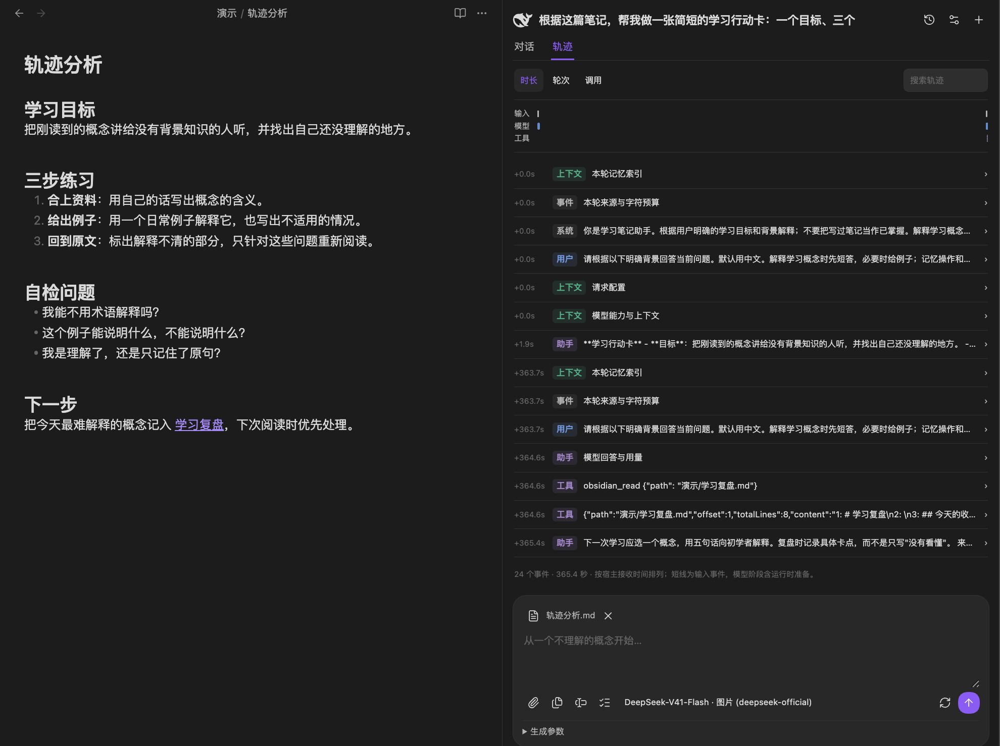
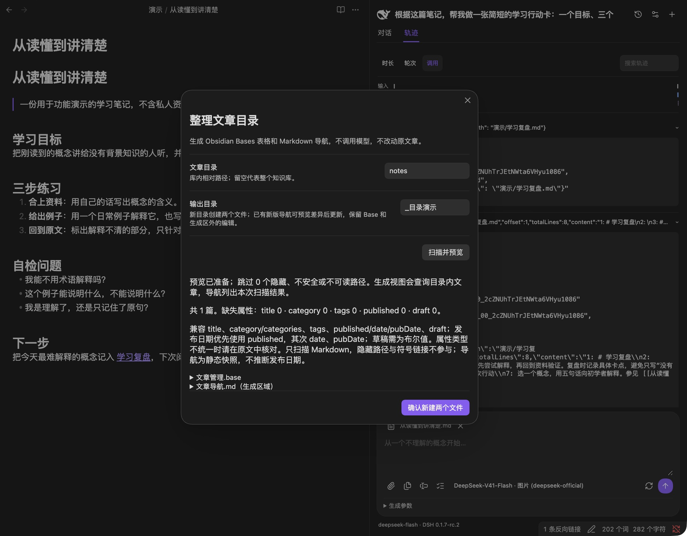
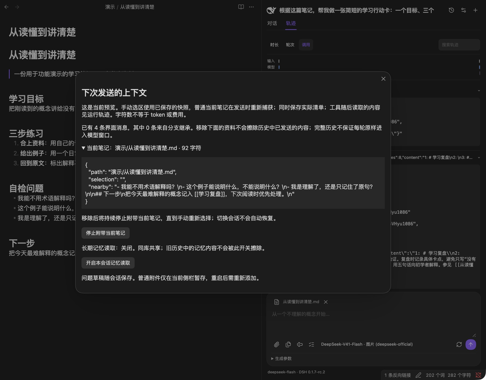

::github{repo="DrTonks/deepseedian"}

造这玩意的初衷是我想在写博客时能够随时查阅、做笔记和问答，obsidian有个工作区/知识库的概念，直接做个侧边栏实现AI概念问答感觉是个不错的选择。调研的时候发现以前有个叫**claudian**的项目基本实现了我要的大部分功能，但是它现在已经死了。我决定参考它仿造一个基于dsh的笔记侧栏助手，于是命名为deepseedian。

基于dsh的好处是可以直接用dsh的trace数据监控，思维链和工具调用也都更加透明：



当前的deepseedian仍然是玩具性质的。查资料我可以直接用其他家的通用agent，如果是为了直接用来”续写博客“、提炼我的文风之类的，感觉现在的大模型还做不到。特别是deepseek现在已经完全不说人话了，需要好好调教，我没那个耐心。

这个插件将dsh单独运行在一个node进程上，并直接链接已保存的供应商模型。虽然是将DSH单独拉取出来运行，但是**长期记忆仍由 Obsidian 插件负责存储、检索和修改；DSH作为Agent运行时负责让模型判断何时调用这些工具。** 换一个会话，插件仍能读取同一知识库的记忆文件，因此实现跨会话记忆。

| 内容      | 保存与使用方式                  |
| ------- | ------------------------ |
| 会话历史    | DSH 持久化会话，并在续聊时恢复历史      |
| 本库长期记忆  | 插件保存独立条目，每轮提供索引和检索工具     |
| 当前笔记上下文 | 本轮附带选区、附近段落、附件，或调用笔记工具读取 |

被落盘的记忆我们称之为**长期记忆**，大致保存结构如下：

```
知识库/
└─ .obsidian/plugins/deepseedian/
   └─ memory/
      ├─ topics/general.md
      ├─ MEMORY.md
      ├─ RULES.md
      ├─ state.json
      ├─ journal.json
      ├─ transaction.json    # 写入过程中使用
      └─ writer.lock         # 操作期间使用
```

实际写入 Markdown 时，用隐藏注释保存元数据：

```
<!-- deepseedian-entry {"id":"…","createdAt":"…","source":"用户手动保存"} -->
我熟悉前端；首次出现的 agent 术语请配简短解释。
<!-- /deepseedian-entry -->
```

阅读时能看到正文，程序则能从注释恢复 ID、来源等信息。当前解析器也兼容旧的 `deepsidian-entry` 标记。

## 如何加载记忆

每次发送问题时，插件会：

1. 检查全局和本会话的记忆读取开关。
2. 从磁盘读取完整记忆，生成一个**快照**。
3. 根据当前问题对条目排序。
4. 取前 12 条，生成每条最多 160 字符的摘要。
5. 把这份部分索引和使用规则追加到本轮提示词中。
6. 模型需要使用某条记忆时，再调用 `memory_read` 核对全文。

**快照**就是这一轮固定使用的一份数据副本。生成回答期间，你在管理界面修改记忆，普通读取不会突然换成新数据；下一轮才重新加载。

初始索引大致是：

```
{
  "vault": "本库UUID",
  "revision": "内容版本哈希",
  "total": 23,
  "index": [
    {
      "id": "条目UUID",
      "summary": "熟悉前端；首次出现的 agent 术语请配简短解释。"
    }
  ]
}
```

其中，模型每轮收到的索引不是直接读取 `MEMORY.md` 的结果。它从条目正文重新排序、生成； `RULES.md` 不会随普通问答自动注入，普通问答收到的是记忆索引和代码中固定的使用规则；用户整理规则主要在提炼任务中使用。

一轮输入大致按这个顺序拼接：

```
插件的固定说明
当前笔记上下文
你的问题
附件内容
本轮长期记忆说明和摘要索引
是否允许管理记忆的说明
```

其中记忆索引最多包含 **12 条记忆，每条摘要最多 160 个字符**。模型需要使用具体偏好时，提示词要求它调用 `memory_read` 核对全文

检索的时候是简单的关键词匹配，没有 embedding、向量数据库或语义重排。

## 记忆整理

记忆的整理分为闲时整理和主动触发的整理；主动触发就是检测到用户说了”记住“、”帮我整理一下最近的工作，形成一条工作流“之类的类似指令，由模型自主判断和进行记忆整理。整理得到的修改建议不会自动覆盖，而是交给用户决定是否加在上下文中；除此之外，也可以手动进行整理：



同意之后，可以自行查看被注入的记忆上下文：



闲时整理的机制类似，就是用户长时间（10-15分钟）不再输入任何内容时，后台启用一个子agent去梳理这段对话和近期对话历史，整理出值得记下的信息。这个机制参考的是claude的”闲时小tip“和auto-dream。

之后可能会朝着更有用的地方推进，比如更直观的上下文拖拽加载（dag那种可能要考虑破坏缓存结构，之后再研究一下）、比如我很想做的”TAB补全“，尽管我不认为它真能起到什么作用，但是按一下tab就把我后面要说的话补出来，想想都很方便，哈哈。

dag就是类似下面这个仓库实现的那样，我还没想好怎么接入：

::github{repo="chenxiachan/thoughtdag"}

插件上架之后才发现已经有两个类似的了，明明做之前还没看到来着，看来是工期拖了太久。当然这类插件不太会有什么热度，倒也无所谓了。

之前看到有人说AI时代下创意是最值钱的，但是我觉得这个时代人人都可以随时将自己的创意变现，而且用AI能快速实现到很高的质量，难点更多在于运营和推广。