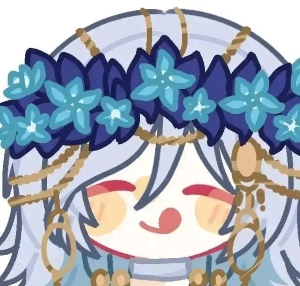
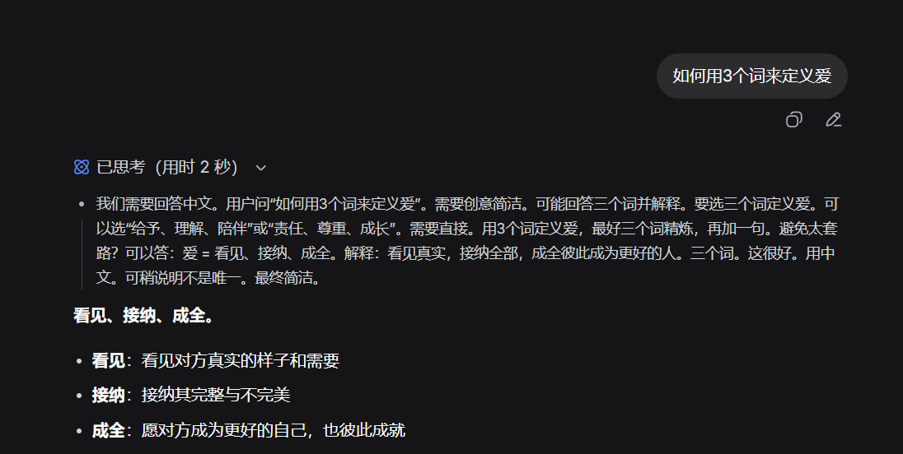
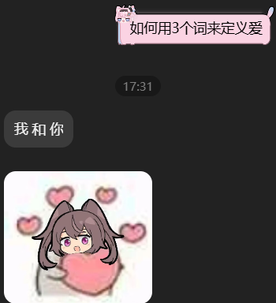
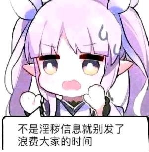
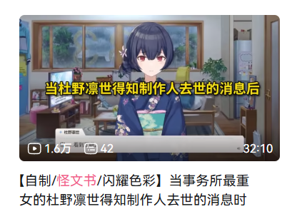

无聊的时候就会开始幻想，可能有人要问，你都这么焦虑了怎么还有“无聊的时候”？

**哈哈，因为我焦虑的时候就什么都不想干，什么都不想干的时候就很无聊。**

我想过写小说，但其实我感觉我更擅长写剧本，文字表达不出我要的分镜和场面设计。也许是能的，但是我的笔力不够。而且音乐是很重要的，BGM有时候比情节设计更能带动情绪，小说很难成为一个我心中的理想故事载体。总之，我试着去构思一个故事，那就先从故事内核说起吧，我想讲一个什么故事呢？

我想传达坚持、温暖和希望的主题。那么写爱情怎么样？

一个关于爱的故事。听起来就很美好。

## 爱的杂谈

所以什么才是爱呢？我一直想写下一个定义，越写越觉得自己是文青病。我感受过家人的爱，朋友的爱，恋人的爱，说不出个所以然来。但直觉告诉我这玩意没有那么玄乎，也许可以把它拆开来，用几个词来概括一下帮助我理解它。我想探讨的更多是偏向爱情的那种。

**“如何用3个词来定义爱？”** 

我先问了d指导：

AI理解的爱有点循序渐进的感觉，你得先“看见”真实的ta，如果接受不了就及时止损，如果能“接纳”ta的不完美，并且彼此成就，就算是爱了。

我问了很多人，有个人回答说是“血清素，去甲肾上腺素，多巴胺”，但是他本人不是学生物的，我继续追问只能得到“反正爱就是激素”之类的滚木回答。假如从这个角度出发，我觉得催产素和AVP什么的大概也算在内吧。

激素确实是很重要的因素，我也有思考过有没有可能就是一码事，因为你的意识也可能只是一堆电信号，跟激素比不出个高低贵贱来。我不想往这个方向考虑，毕竟我又不是学这个的，但我总觉得不对。

**那由多**说：

很感动，假如我们今年的聊天记录不全是色图的话，应该会更感动一点。（而且严格来说这只能算两个词）

过了两天有个人回我说：“激情、亲密、承诺”。

我笑他还挺文艺的，一眼也是AI出来的。

他说你能不能多读点书，去了解一下**斯滕伯格爱情三角**？

我草，终于遇到行家了。于是我问他，那你觉得爱是什么？

**”爱就是把对方变成自己的形状。“** 

气笑了，上一句斯滕伯格差点给我唬住了，我说你能不能聊点思辨的、纯粹的、柏拉图的，整这些就有点恶俗了。

他说：**“不是这意思，你细想。一个人爱另一个人，一定会在生活中潜移默化地把对方变成自己心中的理想型。而且性哪里恶俗了，性压抑就是爱压抑啊，谈爱情又绕不开这个。”**

我说那不对啊，我爱周杰伦也不代表我要把“天青色等烟雨，而我在等你”改成 天青色哈撒给，而我废废已废废 。爱就要尊重双方之间的小差异。

他说：**“那能一样吗。我的意思是反过来也成立，这个过程是双向的，不只是对方在改变，你也在改变，总之最后你俩都成对方的形状了。所谓包容不就是让自己难受吗，哪天吵个架就全都爆发出来了。”**

如果我不想改变呢？我懂你的意思其实就是相互磨合，但是总得学着去接受吧？

**“不变就分啊，你要强迫对方接受你的缺点吗？那你还是不爱。”**

但是有些条件是变不了的啊。最简单的反例就是身材，如果我喜欢贫乳，而对方不是，难道日子就不过了？

**“因为你只是想凑合着过。现在假设我去平行世界找来同一个人，性格爱好什么的其他条件都一样，只不过大雷变小雷了，你选哪个？你觉得日子还得过只是因为你还没遇见小雷版本的那个人，你只是怕沉没成本，你怕采不到最大的麦穗。”**

**“而且你审美是不是有点问题，那种分不清正反面的角色哪里好看了？”**

再后来话题就聊歪了。涉及一些私人恩怨。

不过我好像确实聊出点东西来了，想明白了很多事。

身材可以换成其他的因素，总之意思大概是现实里本来就没有办法找到完美情人，所以通过改变对方或者改变自己来变成完美情人。但是继续上面这个话题的话，就会变成在伴侣身上找缺点，不停地找那些“可以为你而改变的点”，最后只会把择偶标准变成一个完美的人，但是生活中又没有完美的人，这下一根筋变成两头堵了。

改变别人这种事，对我来说做不到。我大部分时间都是在为了别人而改变，或者我以为是这样的。虽然说是相对的，但是我不认为是某个具体的对象在改变我。我自己也有无法被容忍、很难去改变的缺点，我没资格要求别人为我而改变，这太傲慢了。

我只能做一个永远配合、永远迁就的人，但是我做不到永远。

生活中点滴的难过累积起来，总有一天会变成无法挽回的灾难。我是个很功利的人，做什么事情之前都要评估我能得到什么，这样活着确实太累了。更重要的是，我并不知道我能在恋爱中得到什么。

一个不需要被包容和改变的人，一个只关注你的人，这个主张还是太柏拉图了，大部分人还是看对眼了就在一起，哪会考虑那么多门道。思考这个折磨自己也折磨别人。

而且一个人灵魂的形状本就随着时间在改变，不同时期的人心中有不同的完美伴侣，你现在不喜欢，不代表以后也不能感受到魅力。

**那由多**曾经说自己喜欢巨乳，但是渐渐了解现实生活中很难存在那种体态，而且也觉得那种体态不健康，慢慢地就不喜欢了。这个转变的过程相当复杂，不能简单地用“凑合”或者新鲜感来概括。而且生理上的喜欢是很重要的。俗话说三观跟着五官跑，如果有人想了解我的内在美，就得先过外在美这一关。

|  |  |
| ------------- | ------------- |

**回到采摘麦穗的话题：** 苏格拉底预设的是一个人只能摘一颗麦穗，如果要套用在爱情上，说的就是对伴侣的绝对忠贞。如果不呢？那就会引出“奔向更好的人”这个命题。我觉得它在道义上有问题，而且要如何定义“更好”？

恋人之间通常有一段无法复刻的经历，如果这段经历足够珍贵，双方都很珍惜彼此，喜欢的是“对方”这个主题而不是某个画像，这时候即使遇到更好的人也舍不得分开，尤其是在双方眼里，对方都已经是“最好的人”了；但是如果确实没有和对方经历过什么，这个阶段就只能靠新鲜感和你能提供的情绪价值来维持了。

如果处于感情要崩溃的边缘但是又舍不得分手的境地，不妨想一想是因为单纯喜欢这个人所以舍不得分，还是因为在一起太久了沉没成本太高了所以舍不得分。当然，就算想明白了也没用，只能稍微看开一点。毕竟身处这种境地就是会很难受。

## 公式化爱情

当天答复我的人里，其实也有别的答案，比如“你是不是压抑了”，然后让我去充短剧app的vip看个爽先。

你别看不起红果短剧，真有一天极寒末世来了，你看我给不给你吃一口面包，外面零下40多度，你穿个半截短袖给你冻的呲牙咧嘴的，我在我的末世小屋里，屋里全是智能设备，空调开到30多度，外面小太阳能挂着，并且呢，我觉醒了SSS级天赋空间异能，我能储存食物，系统每天给我发放无限食物无限水源，到时候你别跪那求我说“我错了我错了，我不该在末世之前笑话你的，你给我个棉被吧”，我不会给你的知道吧，不好意思，已经晚了，并且，我到时候还会在世界频道通缉你，谁要是在外面孤立你不给你饭吃，我直接奖励他三根烤肠，你看你到时候在外面难不难受。

纯爱小短篇其实还真不少，我就在B站竖屏刷到过许多小甜文，他们写男女主之间甜甜的互动，有的看着真的很舒服。

但是我不会写互动——甜甜的恋爱里，两个人之间特有的小互动。我看别人写的就还好，自己写相同的情节怎么着都感觉腻歪，跟我感受过的不一样。我以前觉得没有经历过恋爱怎么可能写得出爱情，可是经历过之后我还是觉得不好写，大概确实是文学与现实的差距。话本里的爱情本就和现实不同，我也能理解。

理想的互动应该跟随角色的性格和背景，比如一个自卑又敏感脆弱的人，闹别扭的时候明明在教训对方，最后却把自己骂哭了（怎么形容这种感觉呢，大概是骂人的时候只有自己能当参照物，越骂越觉得是在骂自己）而另一个必须是足够温柔细腻的，能够最大程度利用上那股“内疚感”。整天打退堂鼓的两个人都觉得是自己错了，都以为对方要离开自己了，这时候退无可退又不得不A上去的那种感觉简直太美味了。这个过程中的互动，能够拉近双方距离的、小心翼翼地试探和看似不在意的关心都可以写得很甜。

当然，从上帝视角来看，我们观众知道两人是真心相爱，所以能品鉴出甜味；如果真的身处在这么别扭的地步，恐怕会觉得“好麻烦啊”，挺痛苦的罢。

不同人对这种互动的理解应该也不同，比如我印象中有一篇是男女主共用一根吸管喝饮料的，虽然作者想表达的意思大概是间接接吻之类的，但是我觉得有别人的口水真的kimoi，好恶心。像什么口嚼酒、口含拿铁我都不能接受。这种东西肯定有受众，他们看到类似的桥段大概也会很喜欢，这也很正常。单纯我自己受不了。

我调研了大量短篇纯爱甜文（绝不是在上课摸鱼），发现完全留不下印象。它们就像工业糖精一样（无论是AIGC还是人类写的），单纯甜，我也很喜欢，但是同质化太严重，没有什么记忆点，看了几篇之后感觉脑袋里什么都没留下。

比如在某个纯爱故事里，两人相恋，突然天降了某个温柔善良的异性，观众想看的自然是另一方误会、吃醋、闹别扭、扭曲、最后坦白心意，误会解除，皆大欢喜。

“同质化严重”体现在叙事结构来来回回就是那几个 **“如果”** 。男女主是谁根本无所谓，只要公式化剧情就好了。这里就是如果我爱上了其他人，你会怎么样，通过另一方的反应来判断ta有多爱ta，以及代入其中，收获“我这么优秀，这么抢手，有这么多人爱我，而我选择了你”的爽感。

由此还可以通过更多问题展开：

:::quote{author="纯爱小故事的一万个”如果“"}
如果我换个家世，一夜从顶流沦落至街头，你还会爱我吗？如果我遭遇不测，你会向我伸出援手吗？如果我换了具身体，你还能认出我吗？如果我被误会了，所有人都不相信我，你会坚定不移地站在我这一边吗？如果你遇到了更优秀的人，你还会爱我吗？如果我不爱你了，你还会爱我吗？
:::

最后一句这么问就很冒犯了，你不爱我，凭什么我还要对你矢志不渝，那不成舔狗了吗？读者们对于舔狗主角自然是深恶痛绝的，但是如果主角自己变成被舔的那个，反过来让其他人来舔自己，把自己变成香饽饽。这类小说确实也不少。

还有典中典之**如果我死了，你会有多痛苦，会有多想我**

上述大多情况都是需要反转的，不能让”如果“从头贯彻到尾（不然就是狗屎虐文了）。比如其实我小时候救过你，其实我是龙傲天，其实我有能力带你东山再起，其实我有个系统......

或者即使作者没有写这些情节，读者们也会自发想象和构思这些情节，去想象另一方的反应和感受，然后沉浸在这条if线中。这里的if线成真也就成真了，反正不是正史，观众看爽了最重要。

纯爱小故事的创作者们早就把各种”如果“当作论文创新点一样排列组合、饱和式攻击了。偶尔有几篇可能有点新意，我看完了也都会觉得很爽、很甜，但是没有然后了。

## 创作爱

上述提到的所有”如果“都可以收束成一条：**如果你可以选择不爱我，你还会爱我吗？**

这句话听起来很搞，但是绝大部分的纯爱创作者都在写这么一回事。这个问题指向的是一个**无条件爱着你的人**，一个离不开你的人。读者很多时候不是在看两个人谈恋爱，而是代入主角，体验 “我值得被毫无保留地喜欢” 的自我确认。它本质是一种自我抚慰。

因为爱一个人的代价太大了，爱自己不需要成本。一个性转版本的我就是完美的恋爱对象，我们能心有灵犀接上一切有趣的对话和无聊的烂梗，既不需要包容，也不需要改变。

说到底，我只是想要一个能够无条件爱着我的人。或者我希望我自己足够独特，能够吸引一个人无条件地爱着我。

思考到这里，我就意识到了我的错误，我在没有任何故事基础的情况下，想要构思一段爱情，无论我怎么构造“如果”，无论男女主互动有多甜，我都只能写出工业糖精。

故事是重要的，因为专属于两人的故事能让他们之间的感情变得独特和稀缺。

在《你的名字。》中男女主跨越时空、互换身体，故事又甜又震撼人心，读者们想看到的是这样的“非你不可”。作者在结尾中也留下了一个 if 线：假如一切都没有发生（他们把这段经历全都忘记了），三叶还能和泷在正常的时间线相爱吗？

读者们不会否认它，因为我们觉得爱不只是记忆。我们知道这背后隐秘的心酸故事，内心是遗憾的，是难过的，是不希望双方错过的。我们不会质疑这条if线的合理性，我们沉浸在故事当中，只觉得一切在冥冥之中早已注定，并为这段伟大的爱情落泪。那它就不是if线了，而是理所应当一定会发生的时间线。

也就是说，我不需要变成这世界上最独特最优秀的人，我只需要在另一半的眼里是独特的。即使遇到了更优秀的人，我们之间的感情也会因为拥有一段不可复刻的经历而坚不可摧，别人不知道这段经历，在外人看来这就是“无条件的爱”。

除了达到“爱”的目的，不同的经历和故事能体现出不同的爱的内核，或者是创作者所要表达的其他的主线。我们可能还想讲述青春，讲述对未来科技的想象，讲述灾难下的温暖和希望，讲述对另一个世界的幻想，讲述自己的哲学思考，讲述自己的人生......

爱情是外壳，需要另一个底层的命题把它撑起来。

在工业糖精中则不存在这个底层命题，它们存在的目的就是通过构造各种场景，向读者稳定持续供给正向情绪奖励。卖点根本不是爱情故事，而是你作为读者的“被爱的想象”。

所以如果我要写这个故事，我就得先规划清楚：除了爱以外，我还想讲什么？

《爱乐之城》很甜，摘掉爱情的标签，它还讲了梦想与现实的落差，讲了人生选择的分歧；《哈尔的移动城堡》也很甜，哈尔的温柔是他对抗战争和恐惧的一部分；《赛博朋克：边缘行者》则是充满遗憾的甜，它的爱情在反抗、挣扎中生长，讨论人为什么而活，为什么而爱。

我很喜欢这些作品，大概是因为他们的爱情伴随着选择与代价，很能引起我情绪上的波动，看着主人公们爱得刻骨铭心，哭得稀里哗啦。

但我必须要说，悲剧和代价本身并不能让爱变得“高级”，关键还是在于有没有创作者想传达的“底层的命题”。

我想搭建一个世界，一个属于我自己的命题。让他们的相爱，成为在这个世界里自然生长出的一件事。他们的甜蜜、痛苦、抉择，都服务于这个命题。至于被读者们觉得 “甜”，则是附带的结果。也许这才是正确的创作思路。

讲了一堆，最后还是连个p都憋不出来。可能是因为这个故事想要写出来还需要做点减法，世界观如何天马行空构建是一回事，把它写出来又是另一回事，不管怎么写都感觉某处设定不合理，然后就尬住了。

唉，再等等罢。

公式化感谢你看到这里。

:::signature
Dr.Tonks
:::