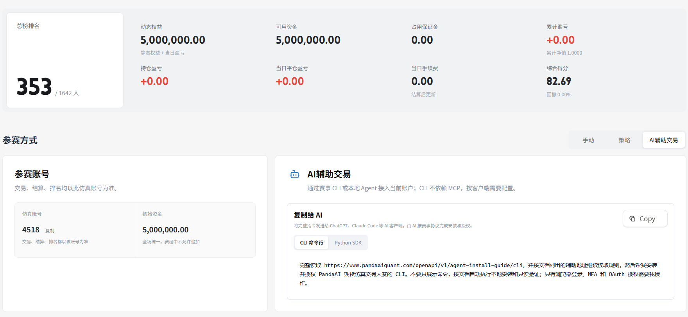
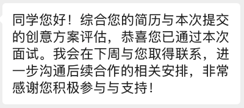

# 还没有准备好

我害怕实习。当然也许我害怕的不是实习，是取得实习offer的过程。

科研实习可能相对来说比较看成绩。我想我确实没有什么拿得出手的成绩。

我以前就一直觉得我没什么拿得出手的成绩。工作室里的学长说：**“你们要去打些竞赛，竞赛没成绩很难保上的，混个省奖也行。”** 

我们学校省三才加0.1分，而最低的国奖都有1.5分。我当时就想，怎么着也得在大三前拿个国奖，才能算拿得出手的成绩吧？

折腾了一年，我现在确实有了国奖，可我们的项目含金量没那么高，算法没那么创新，“都是包装的”，答辩表现也没那么好......按照这个逻辑，它依然是拿不出手的成绩。

对于一个即将修完大学所有学分的人来说，AI像一把利剑斩断了我大学前后的编程生活，现在坐在电脑前看AI写项目的我，很难想象我大一居然在一个字母一个字母地敲js和css。

我们挑战性综设的老师说：**“你们上上一届的学长学姐，大三这个时候的项目还是有一堆bug，最基础的那种bug，都要结课了还得修一堆东西。你们现在半个学期就做完了，运行得也都很流畅很好，还有时间能提一大堆创新点，当然这个不能说是坏事哈，就是现在这个课，我感觉它都不能叫挑战性课程了。”**

随之而来的是认知投降，当AI在输出一大串一大串看起来就很有逻辑、很理性和正确的话时，我会下意识忽略项目细节，只知道这件事做完了，可喜可贺。

某天我打开所谓“自己的项目”时，我发现一个字都讲不出来。我让AI生成了一大堆讲解这个项目的markdown文档，我一个字都看不进去。我还是完全不了解它。我向前辈咨询这个问题的时候，她很不理解：“你和你同事一起干活，你是看不懂你同事干了什么，但是工作完成了才是重点不是吗，你管那么多干什么？”

那也不对。我难道可以跟面试官说，这个部分不是我做的，是AI做的，所以不要问我吗？

我想错了一些事情。

我一直在拿我的能力和AI的能力对比，由此得出没有人会要我的结论。但是如果使用AI本身就是我的能力呢？我的工作流、工程思维、想象力，这些也许正是他们所需的，面试的时候，展示这些能力才是重要的，当然具体的项目细节也要熟悉。

我很讨厌这种感觉，也就是展示自己的部分。我没办法长时间记清楚每个细节，而且我又不止这一个项目。项目细节背下来了，还得背八股，再去看别人的面经，又发现一个都回答不出来。我必须重新强调一遍**我真的真的很讨厌面试**。

当然这主要是我的问题。如果我再努力一点，是不是一切都会好起来呢？

那为什么不能等到寒假再说呢？那时候就有时间准备简历上的项目了。那时候就有时间背了。

唉，我都知道。我只是想要做点什么。我太焦虑了。

但我真的还需要做点什么吗？课业都还没结束呢。

既然你没办法兼顾课业和实习，为什么不专注于先做好某件事呢？

我不甘心。我也想早点找到理想的方向，而不是被学校和环境推着走。我在那个小城里被推着走了18年才考上了“自由的大学”，我不想继续在人堆里迷茫。

**Yau说：“中国社会长期形成了一套很强的‘回报导向’，读书要改变命运，竞赛要升学，研究要换取职位和经费。所以中国学生会解题不会提出问题，不仅仅是教育方法，更深层还是评价体系和人生目标。”**

我能感觉到我不会是那种“提出问题”的人。也许我并不是科研型选手，但是在现在的大环境下，我不读研还能做什么呢，继续鼓捣前端吗？我想是没有什么出路的。

如果我什么都不做呢？

今年国庆期间，我报名参加了巅峰交易者全国期货模拟赛，结果转头就把这事忘了。过了一个月想起来有这回事，上去一看发现自己排名还挺高。

可人生毕竟不是期货交易，不能真的什么都不做。如果可以的话，我愿意做空我自己，然后一摆到底了。可是谁又愿意成为我的股东，为我的空单承担损失呢？那不是啥子吗？

之前看到过一个帖子，标题是 **“永远在还没有准备好的情况下把自己推出去”** ，其实道理我都懂，我不用点开也知道内容是什么，无非是鼓励自己要自信大胆尝试走出舒适圈balabala，可我就是做不到。我感觉自己准备得还不够。每当我觉得我准备好了，“是时候把自己推出去了”，过往的一切在台上的糗事都会在脑海中接踵而至。英语的口语考试，明明已经提前打好腹稿了，明明是自己很熟悉的话题，总是会突然宕机，总是突然不知道下一句讲什么。上台发言，本来准备了一堆内容，站上去就只会复读ppt了。

如果我准备好了再把自己推出去都做不到表现良好，我怎么可能会在没准备好的情况下把自己推出去呢？

人都是逼出来的。按照那个帖子的理论，也许我不知道我的临场发挥能力很好，能让我在危机时刻表现超常？但要是我的临场发挥能力足够好，我也不至于在这么多次公开讲话的场合里把事情搅得一团糟。

我还是太悲观了。家庭的一些变故，课内学业、准备实习的压力压得我喘不过气来。我知道我没必要把自己搞得这么累，可是我很怕如果我不这么做，会不会就会迎来最坏的结果。以前母亲告诉我，等她熬到我弟弟18岁了上大学了，这个家就该散了。我不想这么悲观，也许离婚是气话，但是如果这段婚姻只能给她带来痛苦，我会毫无保留地支持她。

我不想恨我的父亲。我可以窥见他的压力有多大，也知道他为这个家付出了多少。我没有可以恨的对象，我只能恨自己还不够好。有父母作为反例，我大概不会选择踏入婚姻的殿堂，我怕我教育出的后代会是另一个我。

我也想过逃避，转生异世界对我来说是毫无负担的选择，我根本不在乎身后事，但也正如我曾经写下的那样，我决不会主动寻死。如果在大学毕业前转生异世界的话，岂不是说我上了一辈子学？而且我还有许多想做的事，至少也应该回报我的母亲。就当是我可怜的自尊心在作祟，我还不能倒下。

总之，一个莫名其妙感觉自己需要做点什么的人，在大三的时候决定给自己找点事情做，比如科研实习。我发了好多邮件，大都石沉大海，一些回复的也基本是婉拒。第一个实习面试如上一篇所述，没答出学长想要的东西，于是理所当然地寄了。

我还发现一个问题，我不敢发送信息给陌生人，总是要打半天的草稿，做一堆心理准备。

我为什么不敢发呢？

会不会觉得我太麻烦了？会不会是我漏看了什么消息？会不会我本来没必要打这段字？

学长学姐说科研实习比企业实习好进，因为你主要是进去给老师打白工的，成果产出也只能看运气，风险高而门槛低，但作为读研前的经验积累来说是很重要的。其实我不觉得门槛低，因为现在外校的老师不想花太多精力去培养一个不一定能留组的学生，而本校的老师会推荐你保本校。我很难拒绝来自老师的好意，但是我又不想呆在成都。

这段时间，好像变得特别漫长，特别平静。（也可能是因为在等回信）（我发现我一直都喜欢用括号的形式补充对话，明明可以直接打个逗号写在正文里的）（这种做法有点像GPT的防御性不粘锅说明，不过我的写作习惯很早开始就初现端倪了，因此不代表我是学GPT的，也不能据此说明这种写法有问题）（上一句确实是学的）

我慢慢开始在出现在操场上了。

我又重新开始构思和写作了。

我最近不再把午睡当作是任务，感到有点困了就靠着椅背，有时候再睁眼就到饭点了。

我也确实想转变一下我的风格，重新审视以前的我写下的那些东西，总觉得别扭，不够自然。这是最后一篇吐槽我的生活的博客了（大概）

很快就又有一个老师回信，是中科大和南洋理工大学的联培项目（USTCxNTU）；这次上来就甩了一个考核：

:::quote{author="考核内容"}
同学，你好！我刚刚和陶老师沟通了一下，陶老师希望考察大家的想象力与动手能力，请你在一周内准备一份原创创意方案：
内容方向不限，不能是已存在的成品，需要从你的视角挖掘GPT、Claude这类大模型的潜在能力。
方案提交Word文档，篇幅不超过2页，文档内可以配图。
:::

这无疑是难绷的，因为如果我有什么惊为天人的创新点（还要求没有已存在的成品），那我为啥不自己干？而且交上去了也不代表能进组，感觉考核不太合理。思索了一天，我认为重点在“想象力”和“动手能力”上，而不是原创创意方案，着手写了个看起来没那么创新的方案（当然实际上也没那么创新），而且实验效果不理想。实验发现对比现在的方法，连0.1%的提升都没有，甚至可以算是误差范围。

得知我的创新点是一坨大粪时，我无疑是绝望的。但我毕竟倾注了许多心血，只能把它包装成一块巧克力。看起来确实是符合原创创意方案的要求的，但是撕开包装就会闻到一股臭味，直觉会告诉你这玩意绝对不能继续深入（或许可以，但是我没资源去做改进了）。

我又转念一想：这是好事啊！本来也不会指望本科生能做出什么东西来吧，进组了也是老老实实做导师给的课题，怎么可能继续自己提出的这一坨呢？如果没能进组，那损失的也只是这一坨而已。

我还没有准备好。我只能先把我自己推出去。

也许没有那么困难，漫长的三周过后还是得到了第一份offer。

收到消息的时候确实会稍微缓解一下焦虑。但是我对未来还是比较迷茫的，最近各种AI在各种领域都有所建树，尤其是相当一部分的数学难题的突破。之后如何科研、起步怎么做、相关的基础是不是还需要再打牢一点？我总是在给我自己上压力，临近期末，课内和科研需要一起抓，要化身时间管理大师了。

但是师兄很善良，明确表示你们还有课内要做，发布任务也没有设置一个定死的ddl，说是看个人——但是这样反而让我心里发怵。我理想中的科研模式是给我一个topic和现成的项目去做，而不是让我去调研和发现topic。只能走一步看一步了。

时间比我想象中的充裕，但压力比我想象中的要大。我想我还来得及。

这期没有公式化“感谢你看到这里”。

:::signature
Dr.Tonks
:::