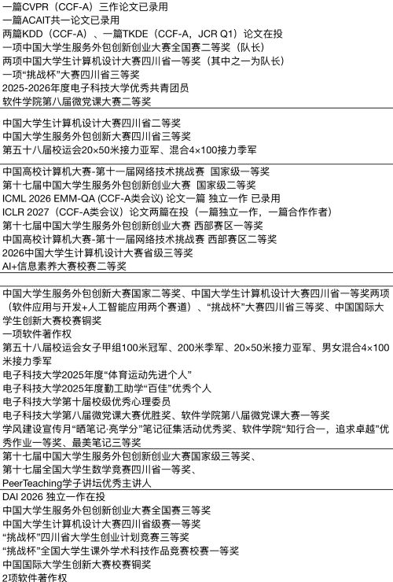
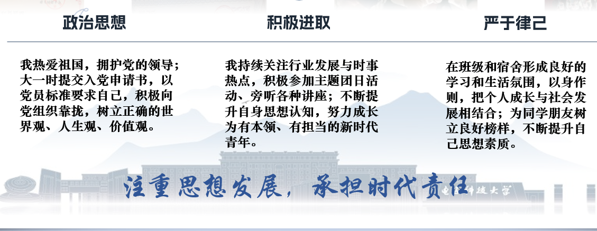
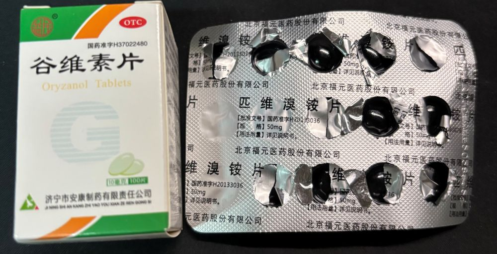
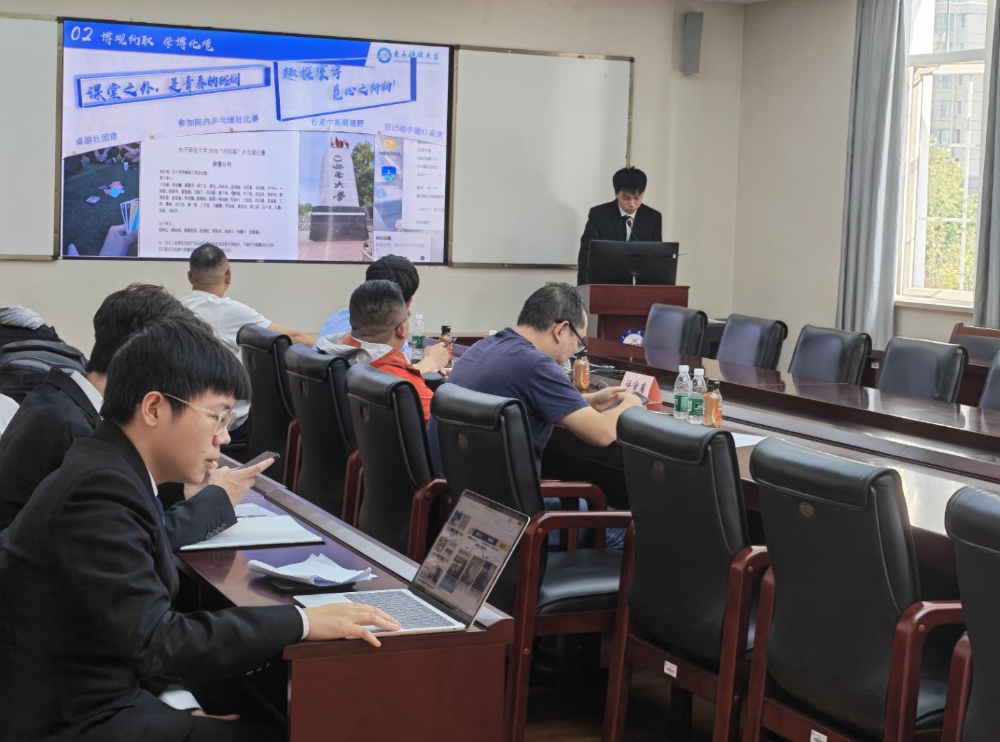

这学期有幸混到了国家奖学金答辩的资格，当然最后并没有成功，毕竟专业排名和科研成绩相比于其他妖魔鬼怪确实不够看。看了一眼其他候选人的过往学术荣誉，直接被吓哭了：

准备国奖答辩ppt的时候我还是下了功夫的，在各种地方取经之后，发现不能太花里胡哨、也不能太简约，还得把我可怜的学年经历捣碎了塞进去，苦也。

科创竞赛和个人简介什么的倒是好写，比较令人头疼的是政治思想什么的，我大一的时候就提交了入党申请书，但是没有选上积极分子，大二第二批报名的时候我又没跟进，遗憾离场了；我在网上找了许多模板，不是入党积极分子就是预备党员，即使是团员，也还有什么优秀共青团员，什么主题团课之类的我也都没有做。

我琢磨了很久怎么写比较不那么丢脸：

想笑就笑吧。这已经是我能想到的最体面的说法了。

除了ppt和答辩稿之类的准备，我还得考虑一下自己的身体状况。前次在课上演讲，从台上下来之后肚子超级痛，会难受好几个小时。医生说是什么“肠易激综合症”，没什么根治手段，几年下来我已经摆烂了。反正只能尽量不上台发言，不知道咋调整。

我真的已经很努力在积极发言改善我的心态了，但是我的肠胃不听我的。我很怕我会在这次答辩之后再次出现这种情况，于是自己去搜了点药物并做了些人体实验：

我在综设小组汇报前吃了两天**谷维素片**，鉴定为没用。问了豆包和GPT说是要长期吃，我可能没那个耐心。

**匹维溴铵片**是有点东西的，我在某次课堂报告之前吃了一片，结果讲后居然真的没有那种痉挛的痛感，问了医生说这个没什么副作用，也推荐我吃。只不过还是治标不治本，有这个效果我已经很满意了。我觉得我做好准备了。

然而直到答辩前的一个周末辅导员才公布答辩时长，只有可怜的3分钟；因此我又得急急忙忙、删删改改，把竞赛经历什么的浓缩成一页，又删掉了思想建设之类的没有实质性内容的地方。搞到最后，也忘记租一套西装了，只能穿一套纯色衬衫企图蒙混过关。

站在答辩室门外，我的心情无疑是沉重的，一个个被叫到号的、穿着西装革履的年轻有为之人走进去、走出来，给我带来了极大的心理压力。我一直幻想以后企业面试会不会也这样紧张。

中场休息的时候我和综设组长走进去提前打开ppt，顺便拍了张答辩室的结构。还好没有和评委面对面会谈。

我本就没有什么获奖的希望，是抱着锻炼语言能力的想法才来到这里的。然而现实比我想象得要更无聊一些：**没有提问环节**。就是上台叽里咕噜一顿讲，之后下台。没了。

答辩不是这样的！你应该听我讲完然后问我相比于其他候选人有什么优势、问我竞赛经历、问我学生工作和思想建设、质疑我ppt里的漏洞和措辞的不准确......

答辩过程中也不用担心和评委们对视导致紧张忘词。因为他们也根本不看你。

评委们很少抬头，大多在低头看学校给的材料，据我目测是看排名和成绩，看得过去就给高一点，成绩不行就免谈。这显然不对，就像公司面试难道只是比谁的简历包装得更厉害吗？答辩面试当然是非常重要的一环，远比纸面的成绩和排名有说服力。

对于那些精心准备过的人来说可能不那么公平，毕竟成绩有劣势的同学自然想着能够在答辩的时候多表现自己，多讲讲自己的课外生活有多么丰富，讲讲自己这一年以来的科研竞赛有多么深入......可惜评委只对rank1-rank5抬头。

总之，答辩的过程实在是谈不上正规。还好我没有花50块租一套西装。

**不过，从某种意义上说，这也是我答过的最舒爽最连贯的辩。** 我建议世界上所有答辩都按照这个流程来。上去机械念稿和播放ppt3分钟以后走下来，看评委十分急切地喊“下一位”，一切都是那么自然，不需要沟通、不需要压力、不需要质疑。太爽了。上台前我还在担心肠胃会不会发作，下来之后啥感觉也没有。

不过可能也只有软院这样。毕竟软院人多，答辩时长被压缩到3分钟以内，评委们也赶着下班，自然是没那么多精力的。电科的某些专业据我所知还是有比较正规的答辩流程的。

唯一的考验和锻炼大概是我站在答辩室外面的胆量。所以即使是软院的学弟学妹们我也推荐租一套西装，不然站在外面太尴尬，有点像志愿者。

感谢宇宙的意志指引各位来看我的笑话。